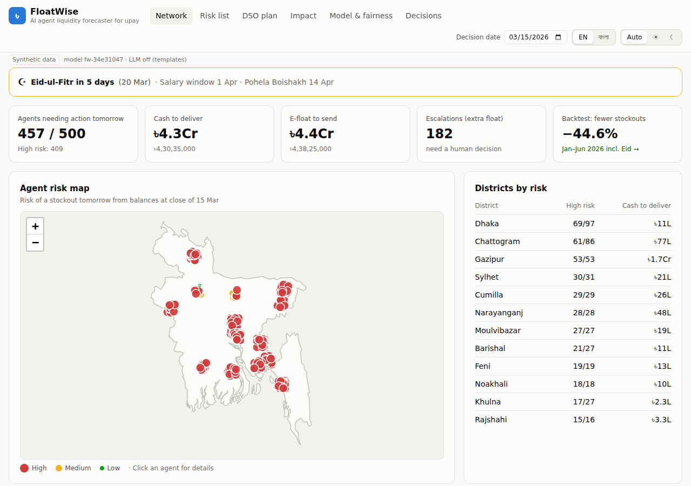
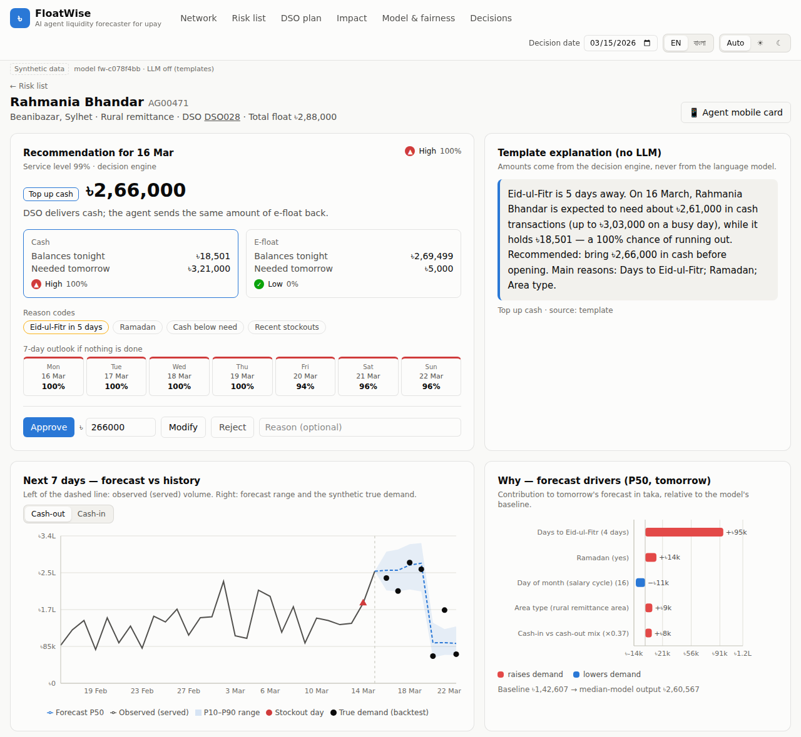
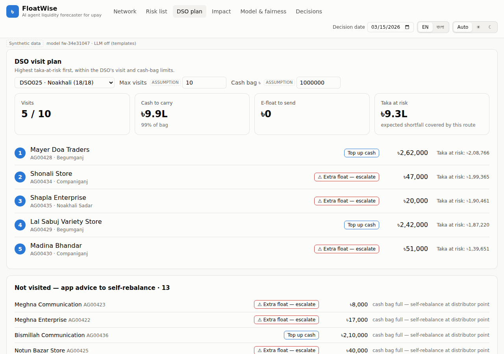
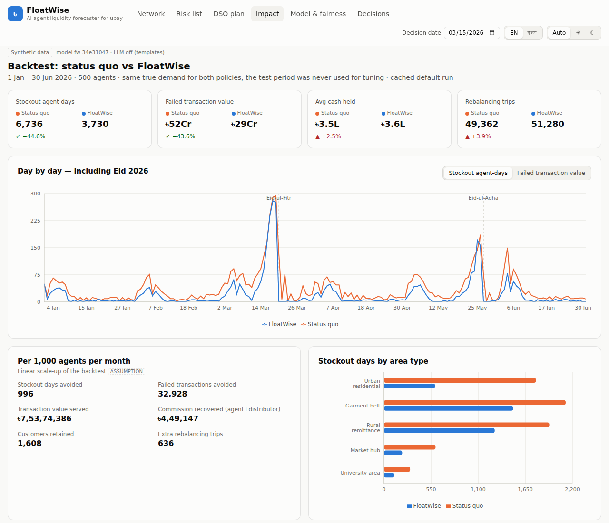
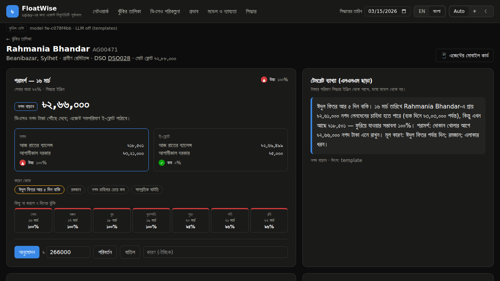
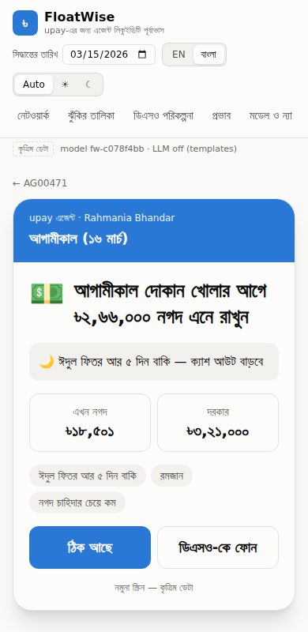
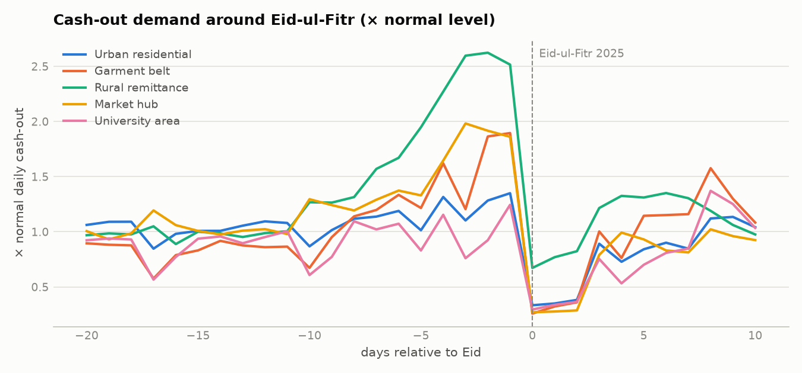
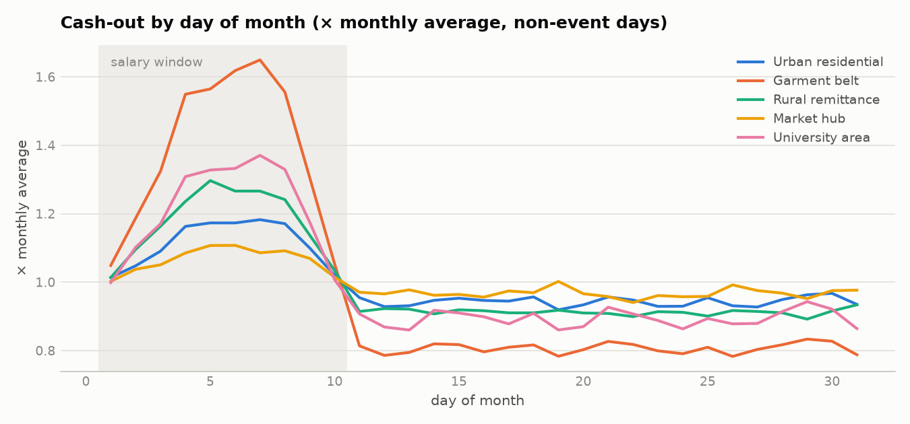
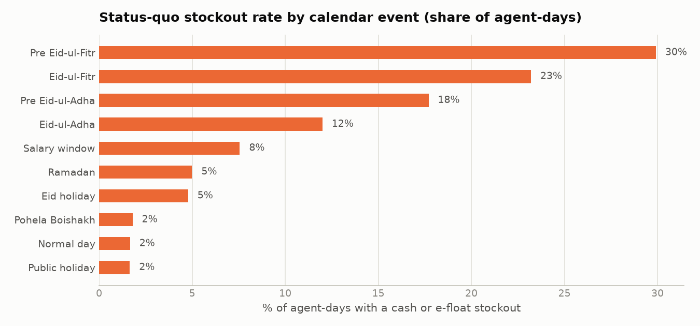

# FloatWise — AI Agent Liquidity Forecaster for upay

[](https://github.com/redwanhasan980/DIU_AI_Hackathon/actions/workflows/ci.yml)

> AI Hackathon 2026 · DIU CPC × upay · Track 05: Merchant & Agent Intelligence

**The problem:** upay agents run out of **cash** (they can't pay cash-outs) or **e-float** (they can't take cash-ins) when demand spikes. This happens around Eid, garment salary days, remittance peaks and government allowance (G2P) disbursements. The customer hears *"cash nai, pore ashen"* ("no cash, come back later"), and upay loses the fee, the agent loses commission, and the customer may switch wallets.

**What FloatWise does:**
1. Forecasts every agent's cash-out and cash-in for the next 7 days.
2. Turns the forecast into a stockout risk and an exact top-up amount.
3. Plans the field officers' (DSOs') visits within their cash-bag limit.
4. Explains each recommendation in Bangla or English.
5. A person approves every action; nothing moves money automatically.

> All data is **synthetic** but shaped on upay's public facts: tariffs, commissions, services and network size. See [`docs/DATA_ASSUMPTIONS.md`](docs/DATA_ASSUMPTIONS.md).

---

## Quick start (about 6 minutes)

**You need:**
- [Python 3.11+](https://www.python.org/downloads/)
- [Node.js 20+](https://nodejs.org/) (includes npm)
- git
- About 1 GB of free disk space
- No API key and no internet once installed

```bash
git clone https://github.com/redwanhasan980/DIU_AI_Hackathon.git
cd DIU_AI_Hackathon

python run.py setup    # 1. install everything into ./.venv and frontend/node_modules   (~1–2 min)
python run.py all      # 2. build data, train models, run the backtest                  (~3 min)
python run.py demo     # 3. start the app → open http://localhost:8000                  (Ctrl+C to stop)
```

- On **Windows**, use `py run.py …` if `python` isn't found. On **macOS/Linux**, use `python3` if `python` isn't found.
- On **macOS/Linux** you can use `make setup`, `make all` and `make demo` instead.
- Re-running `all` reproduces exactly the same model (`fw-c078f4bb`) and numbers.

### Your first 2 minutes in the app
The app opens on **15 March 2026**, five days before Eid-ul-Fitr.

1. **Network:** the Eid banner, KPI tiles and a red risk map of 500 agents.
2. **Risk list:** pick district **Sylhet** and open **AG00471 — Rahmania Bhandar**, a rural remittance shop. You'll see:
   - a **৳2,66,000 cash top-up** recommendation and the 7-day outlook;
   - the forecast range against true demand;
   - the drivers;
   - the explanation.

   Switch the language to **বাংলা**, then press **Approve**.
3. **DSO plan:** change *Max visits* or *Cash bag* and watch the route re-prioritise.
4. **Impact:** the backtest against today's rule of thumb, upay fee revenue protected, and a live re-run with the service-level slider.
5. **Model & fairness:** acceptance checks, error by area type and the fairness table.
6. **📱 Agent mobile card** (button on an agent page): the Bangla screen an agent would see.

### Optional: AI-written explanations
Without a key, explanations come from built-in Bangla/English templates. To use Claude instead:
1. Copy `.env.example` to `.env`.
2. Set `ANTHROPIC_API_KEY`.
3. Restart the demo.

Run `make narratives` (or `python run.py all`) to cache explanations for an offline demo. The LLM only rephrases numbers the engine computed. A numeric check rejects any amount it invents and falls back to the template.

### Troubleshooting
| Symptom | Fix |
|---|---|
| `python` not found / wrong version | Install Python 3.11+. On Windows use `py -3.11 run.py setup` |
| `npm` not found | Install Node.js 20+ and reopen the terminal |
| Port 8000 is already in use | Stop the other program using it, then run `python run.py demo` again |
| Page says "API is not reachable" | Start the API (`python run.py demo`). The demo path still renders from offline fixtures |
| LightGBM import error on macOS | `brew install libomp`, then `python run.py setup` again |
| Want to start over | Delete `.venv`, `data/generated`, `artifacts/models` and `artifacts/forecasts.parquet`, then run the 3 steps again |

---

## Results (held-out test period: Jan–Jun 2026, including both Eids)
Same true demand for both policies; 500 agents. Every number comes from `artifacts/*.json`.

| | Today's rule of thumb | FloatWise | Change |
|---|---|---|---|
| Stockout agent-days | 6,973 | 3,664 | **−47.5 %** |
| Failed cash-outs | 2,15,101 | 1,09,349 | **−49.2 %** |
| Failed cash-out value | ৳52.2 crore | ৳27.8 crore | **−46.7 %** |
| **upay fee revenue lost** (fee − commission) | ৳33.8 lakh | ৳15.6 lakh | **−53.7 %** |
| Agent + distributor commission lost | ৳27.1 lakh | ৳14.5 lakh | **−46.6 %** |
| Customers at risk of leaving | 10,755 | 5,467 | **−49.2 %** |
| Rebalancing trips | 49,813 | 51,860 | +4.1 % |
| Average cash held per agent | ৳3,52,509 | ৳3,60,653 | +2.3 % (honest trade-off; target missed) |

**Scaled to upay's ~1,54,000 agents, per month** (linear scale-up, an assumption):
- **≈ ৳9.3 crore** of upay fee revenue protected.
- ৳6.4 crore of agent and distributor commission recovered.
- ≈ 1.7 lakh stockout days avoided.
- ≈ 2.7 lakh customers retained.

**Forecast accuracy** (cash-out WAPE, lower is better; model `fw-c078f4bb`):

| | FloatWise | Same day last week | 7-day average |
|---|---|---|---|
| All days | **18.7 %** | 39.8 % | 32.7 % |
| Eid days (−7 … +3) | **21.2 %** | 58.9 % | 53.8 % |

- **Fairness:** every area type improves, and none is worse than the baseline. Urban agents: −52 % stockouts. Rural agents: −37 %, because their total float is small for the Eid spike, which is what the "extra float" escalation flags.
- **Known weakness:** forecast ranges are too narrow on Eid days (P10–P90 coverage 60 % vs 75 % overall). The policy compensates with a 99 % service level chosen on validation data.

Details: [`artifacts/model_card.md`](artifacts/model_card.md) · SRS [§6.4](docs/SRS.md) and [§12](docs/SRS.md).

## How it works
```
synthetic upay-like data ─▶ leakage-safe features ─▶ LightGBM P10/P50/P90 forecasts (cash-out, cash-in, 1–7 days)
      ─▶ decision engine (stockout risk, top-up amount, escalation, DSO route under visit + cash-bag limits)
      ─▶ SHAP drivers + Bangla/English explanation ─▶ FastAPI ─▶ React dashboard ─▶ human Approve / Modify / Reject
      ─▶ backtest vs today's rule of thumb (stockouts, failed value, upay fee, commission, trips, cash held)
```
- **Forecasting:** one global LightGBM quantile model per side. The target is "× the agent's normal day", so it learns multipliers ("×2.6 before Eid") that work for agents of any size. Features know the calendar in advance (days to Eid, salary days, allowance days, Ramadan) plus recent history. A test proves no future data leaks in.
- **Decision engine (deterministic):** a demand distribution built from the quantiles gives stockout risk, the amount for a 99 % service level and the expected shortfall in taka.
  - Agent and distributor balances are conserved: rebalancing only converts between cash and e-float.
  - If even P90-level needs exceed the agent's total float, the case escalates to a human as "needs extra float".
- **DSO plan:** an exact knapsack optimiser picks the visits that cover the most taka at risk within 10 visits and a ৳10 lakh cash bag. Unvisited agents get the advice in the app.
- **Explanations:** TreeSHAP drivers in taka, plus a Claude-written or template narrative. The LLM never decides amounts.

## How FloatWise maps to upay
| upay reality (public) | In FloatWise |
|---|---|
| Agent cash-out fee by wallet: primary 1.4 %, salary 1.0 %, remittance 1.0 %, disbursement 0.7 % | Fee per area type by wallet mix (garment → salary wallet, rural → remittance/G2P blend) |
| Agent commission 0.41 %, distributor 0.10 % per cash-in / cash-out | Commission lost on failed transactions; upay keeps fee − 0.51 % |
| Salary disbursement, inward remittance, G2P safety-net allowances, cash-in/out | Garment salary days, pre-Eid remittance surge, quarterly allowance days, daily CI/CO |
| Distributor → DSO → agent network, ~1,54,000 agents (2023) | 500 agents in 15 districts, ~25 agents per DSO, 5 DSOs per distributor; impact scaled to 1,54,000 |
| Customer cash-out limit ৳25,000 per transaction | Synthetic ticket sizes ৳1,500–৳3,000 |

Sources and the remaining assumptions are listed in [`docs/DATA_ASSUMPTIONS.md` §8](docs/DATA_ASSUMPTIONS.md).

## Screenshots
| | |
|---|---|
|  **Network:** risk map, KPIs and the Eid banner |  **Agent detail:** recommendation, outlook, forecast vs true demand, drivers, explanation |
|  **DSO plan:** visits ranked by taka at risk within the cash bag |  **Impact:** backtest, upay fee revenue and network scale-up |
|  **Bangla + dark mode** |  **Agent mobile card:** Bangla, one clear action |

## The synthetic data at a glance
| Eid spike by area type | Salary-day cycle | Today's stockouts by event |
|---|---|---|
|  |  |  |

- **Eid:** rural-remittance cash-out reaches ×2.6 before Eid-ul-Fitr.
- **Salary days:** garment cash-out peaks at ×1.6 on days 5–8.
- **Allowance days:** they add rural cash-out spikes.
- **Today's stockouts:** under the rule of thumb, 30 % of agent-days stock out in the week before Eid-ul-Fitr, against 1.6 % on normal days.

The data also includes floods, outages, hartals, growth and noise. Every parameter is in [`backend/config.yaml`](backend/config.yaml) and explained in [`docs/DATA_ASSUMPTIONS.md`](docs/DATA_ASSUMPTIONS.md).

## How each design choice was made
Every choice was made on held-out data, never on the test period. The evidence is in `artifacts/`.

| Choice | Options | Decided on | Selected | Evidence |
|---|---|---|---|---|
| Stockout-day labels (censoring) | keep / exclude / inflate | Held-out Eid 2025 | **keep**: fewest pre-Eid misses above P90 (57.1 % vs 57.4 % / 59.5 %) | `censoring_experiment.json` |
| Quantile architecture | independent / spread around P50 | Held-out Eid 2025 | **independent**: spread narrowed Eid coverage 51 % → 42 % | `quantile_experiment.json` |
| Service level & risk threshold | 15-point grid | Validation Jul–Dec 2025 | **0.99 / 0.10**: −55 % stockouts, +12 % trips | `policy_tuning.json` |
| DSO route | greedy / exact knapsack | Validation Jul–Dec 2025 | **optimal** (1,689 vs 1,692 stockout days, practically equal) | `allocator_comparison.json` |

## Testing
| Check | Command | What it covers |
|---|---|---|
| Unit + integration tests (89) | `python run.py test` or `make test` | Data quality, no-leakage, models, decision engine, allocator, backtest, explanations + LLM guardrails, API contract and errors |
| Lint | `make lint` | ruff (Python) + tsc + eslint (web) |
| Browser walk-through (21 checks) | With the demo running: `pip install playwright && playwright install chromium`, then `make e2e` | The whole demo: map, agent, Bangla, approval, DSO limits, live backtest, fairness, decisions, agent card, other date, dark mode |
| CI | GitHub Actions on every push | Backend on Linux + Windows, frontend typecheck/lint/build |

## Repository map
| Path | What |
|---|---|
| [`run.py`](run.py) / [`Makefile`](Makefile) | One-command setup, pipeline, demo, tests |
| [`docs/SRS.md`](docs/SRS.md) | Requirements, formulas, API and UI spec, results next to targets |
| [`docs/IMPLEMENTATION_PLAN.md`](docs/IMPLEMENTATION_PLAN.md) | Phased checklist (ticked as built) |
| [`docs/DATA_ASSUMPTIONS.md`](docs/DATA_ASSUMPTIONS.md) | Every synthetic assumption, plus upay facts with sources |
| [`CLAUDE.md`](CLAUDE.md), [`RULES.md`](RULES.md) | Guide and mandatory rules for AI coding agents |
| `backend/floatwise/` | `data/` → `features/` → `models/` → `engine/` → `simulation/` / `explain/` → `api/` |
| `backend/scripts/` | Experiments, policy tuning, narrative cache, fixture export, e2e walk-through |
| `frontend/src/` | React app: `pages/`, `components/`, `api/` (types + client), `i18n/`, offline `fixtures/` |
| `artifacts/` | metrics, model card, backtest results, fairness, experiment evidence, plots |

**API:** while the app runs, the interactive docs are at http://localhost:8000/docs (`/api/v1/...`: agents, forecast, recommendation, explanation, DSO plan, network summary, simulate, decisions).

## Responsible AI
- **Synthetic data only:** no personal data exists anywhere in the system.
- **Decisions vs explanations:** amounts and decisions come from deterministic, tested code. The LLM only explains them, behind a numeric guardrail.
- **Human approval:** every action is Approve / Modify / Reject. Decisions are logged and summarised as retraining feedback.
- **Fairness:** checked per area type and rural vs urban.
- **Clear labelling:** the UI separates predictions, assumptions and AI-generated text.
- **Honest model selection:** made on held-out periods. Missed targets are reported, not hidden.

## Limitations and path to production
**Limitations:**
- Daily granularity.
- Synthetic demand.
- G2P dates are a synthetic schedule.
- Customers don't move to a neighbouring agent in the simulation.
- Live LLM explanations need an API key.

**Path to production:**
1. **Shadow mode:** run on governed, aggregated agent-ledger data (daily cash-in/cash-out per agent; no customer data) from one distributor.
2. **Pilot:** use the DSO plan before Eid against control distributors.
3. **Integration:** connect to the DSO and agent apps, with a nightly retrain and per-segment drift monitoring.
