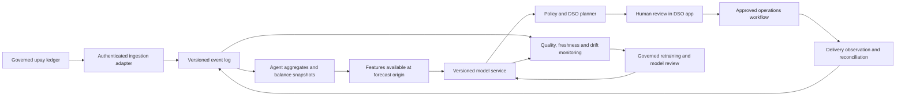

# Proposed deployment architecture and integration contract

Implemented: synthetic historical features, loaded LightGBM inference, deterministic planning,
FastAPI, local SQLite state, password login and cookie sessions, versioned HTTP event ingestion,
a durable SQLite event queue and separate worker, history projections, model registry, distribution
monitoring and human-approved DSO tasks with reconciled simulated completion. See
[INTEGRATION_DEMO.md](INTEGRATION_DEMO.md). The production architecture below remains a design.
No upay system, streaming broker or production database is connected.

## Ingestion and reconciliation

Adapter events carry `event_id`, schema version, event/received time, pseudonymous agent ID,
assignment and typed payload. Types cover served/denied cash-in/out, balances, refill request,
human approval and confirmed delivery. Amounts use integer taka. Source failure codes distinguish
liquidity from network/identity/customer limits. Customer identifiers never enter features.

Validate schema, bounds, ownership, sequence and times. Deduplicate by source/event ID.
Observations are not transfer commands. Handle late events with watermarks and replay affected
aggregates; evaluation uses original availability times. Quarantine bad events and reconcile
totals/balances against provider records before advice.

Use PostgreSQL transactions for snapshots, decisions, idempotency and an outbox. Consumers
checkpoint after commit. Recommendations record snapshot revision, origin, model and policy.
Approval verifies them transactionally. A DSO task adapter exchanges approved plans and
accepted/rejected/completed statuses with reconciliation evidence; message receipt is not proof
of a transfer.

## Serving and capacity

Partition/batch inference by agent/DSO with bounded workers. Store origin/horizon, feature schema,
snapshot revision and model hash. Serve nightly batches and on-demand refresh. Agree freshness
budgets with operations rather than inventing an SLA. Suspend advice for stale/missing balances,
incomplete history or incompatible versions and show a reason for human review.

The balance observation endpoint recalculates liquidity advice. The integration event endpoint
also projects served transaction history; completed-day live inference replaces forecast artifacts
for affected agents. Open history suspends advice until reclosure. The synthetic baseline seeds
earlier history, and all operational data in this demonstration is simulated.
Scale experiments replicate feature rows/balances. The integration benchmark command additionally measures local event ingestion/projection and full
feature construction in isolated databases; its new results are pending execution. HTTP load,
concurrent serving, production databases and retraining need independent benchmarks.

## Retraining, versioning and drift

Register snapshot hashes, availability cutoffs, feature schema, binary hashes, parameters,
calibration record, policy and segment evaluations. Keep fit/calibration/assessment disjoint.
Schedule retraining after quality checks and allow reviewed retraining after drift alerts.
Never automatically promote candidates: compare with the current model and simple baselines on
untouched future data including events, perform a shadow canary and retain a rollback version.

Monitor ingestion lag, missing dates/agents, balance conservation, replay/invalid events,
inference latency/errors, forecast age, feature distributions, censoring, overrides/rejections,
delivery adherence and realized failures. Compute WAPE, pinball and interval coverage when
outcomes arrive, by event, horizon, geography and capacity. Compare separate seasonal references.
Select thresholds/minimum samples on partner validation data; alerts trigger review, never money
movement. The validation page provides offline robustness evidence. The Integration page adds live queue,
inference/freshness/reconciliation telemetry and a sample-gated served-volume distribution monitor.
Real forecast accuracy, seasonally validated drift thresholds and production alerting remain pending.

## Security and governance

Replace local password accounts with the sponsor identity provider, centrally managed sessions, privileged MFA and
service identity. Filter every resource by tenant/distributor/DSO ownership; current roles are
network-wide. Use TLS, managed secrets, rotation, separated DB access, backups and recovery.
Move limits to shared infrastructure where needed: local rate counters are database-shared,
but simulation concurrency is limited per process.

Export audit to a restricted external sink with integrity/retention controls. Review free text
for unnecessary identifiers. Define purpose, minimization and retention before ingestion and
validate security/fairness on governed data. Human approval stays mandatory; LLMs explain
deterministic amounts.
